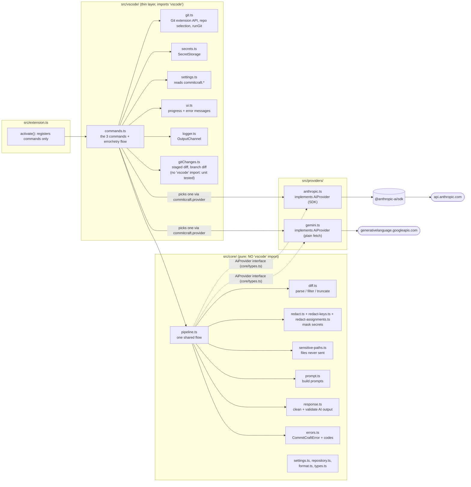

# CommitCraft architecture

CommitCraft is a VS Code extension that drafts commit messages and PR descriptions from Git changes
using Claude. This document explains how it is put together, how data moves, and why.

## 1. Design in one paragraph

All decisions about *what to send* and *what to show* live in a **pure TypeScript core** that never
imports `vscode`. A **thin VS Code layer** gathers inputs (repository, staged diff, API key, settings),
calls the core, and presents the result. The AI vendor sits behind **one interface**, so the core never
knows which provider it talks to. Because the core is pure, almost all behaviour is unit tested without
launching VS Code, and the parts that need VS Code are covered by a small integration suite.

## 2. Module map



Rules that keep this shape (enforced by ESLint, not just convention): `src/core/**` and
`src/providers/**` may not import `vscode` (`no-restricted-imports`); exported functions have explicit
return types; no `any`; no `console` calls.

| Module | Responsibility |
| --- | --- |
| `core/diff.ts` | Parse a unified diff into files; skip binary, lock and sensitive files (names only); fair per-file truncation; render the text that goes in the prompt; plain-language notices for the user. |
| `core/redact.ts`, `redact-keys.ts`, `redact-assignments.ts` | Mask secrets (tokens, JWTs, private keys, URL credentials, assignments in many syntaxes) while keeping every line and its diff prefix, in linear time. |
| `core/sensitive-paths.ts` | Decide which files are never sent (env files, keys, credentials, state files). |
| `core/prompt.ts` | The wording of the commit and PR prompts. Treats the diff as untrusted data. |
| `core/response.ts` | Strip fences and chatter, enforce subject length, validate Conventional Commits and the four PR sections. |
| `core/pipeline.ts` | `diff -> redact -> truncate -> prompt -> provider -> response`, shared by both commands. |
| `core/errors.ts` | `CommitCraftError` with a `code` and a user-safe message. |
| `core/settings.ts`, `core/repository.ts` | Settings normalisation; API-key input validation; branch-name safety; choosing a repository for a file. |
| `providers/anthropic.ts` | `AiProvider` for the Anthropic Messages API: request shape, timeout, cancellation, error mapping (including the no-credit 400). |
| `providers/gemini.ts` | `AiProvider` for Google Gemini through its OpenAI-compatible endpoint, with plain `fetch`: pinned URL, no redirects, timeout, cancellation, error mapping built from live observation. |
| `vscode/gitChanges.ts` | Reads the staged diff and the branch changes through an injected `runGit` (unit tested with fakes). |
| `vscode/git.ts` | Finds the right repository (single, button, active file, ask); runs the Git extension's own `git` binary without a shell. |
| `vscode/commands.ts`, `ui.ts` | The three commands, progress, error messages with a next-step button. |

## 3. Data flow: Generate Commit Message

```mermaid
sequenceDiagram
  actor U as Developer
  participant C as commands.ts
  participant G as Git extension (vscode.git)
  participant S as SecretStorage
  participant P as core/pipeline.ts
  participant A as providers/anthropic.ts
  participant API as api.anthropic.com

  U->>C: click sparkle button / run command
  C->>G: pick repository (arg, active file, or ask)
  C->>S: get API key (offer to set if missing)
  C->>G: git diff --cached with fixed flags (Git extension's binary)
  alt nothing staged
    C-->>U: warning "no staged changes" (no progress UI, no network)
  end
  C->>U: confirm replace if the message box already has text
  C->>P: generateCommitMessage(rawDiff, key, provider, settings, signal)
  P->>P: parseDiff, drop sensitive/binary/lock files (names only)
  P->>P: redact each remaining file, THEN truncate to the size budget
  P->>P: redact file names; build prompt (diff in <diff> tags)
  P->>A: generate(prompt, {apiKey, model, maxTokens, signal})
  A->>API: POST /v1/messages (pinned base URL, effort low)
  API-->>A: message
  A-->>P: text (refusal / cut-off / empty become errors)
  P->>P: clean fences + preamble, enforce subject length, validate format
  P-->>C: text + notices (masked count, truncation, skipped files)
  C->>G: repo.inputBox.value = text
  C-->>U: message in the box, plus a note about anything not sent in full
```

**Generate PR Description** follows the same pipeline. The differences: `gitChanges.getBranchChanges`
finds the merge base of `HEAD` and the base branch, and reads the commit subjects and the combined diff
with the Git extension's `git` binary; the result opens in an untitled Markdown tab instead of the
message box. Failure cases (detached HEAD, on the base branch, base branch missing, nothing ahead of
base) are explicit `CommitCraftError` codes with fix-it messages.

**Cancellation.** The progress notification's Cancel button aborts an `AbortController`. The signal is
passed to the git child process and to the SDK request; the pipeline also checks it between stages. A cancelled
run ends silently (nothing is shown). Cancelling is possible only once the progress notification is up, not during the
Git extension wait or the key prompt.

**While the AI works.** If you type in the message box in the meantime, the result is not written blindly: a modal asks
whether to replace your text, open the draft in a new tab, or keep what you typed.

## 4. Where data lives and what leaves the machine

| Data | Where | Leaves the machine? |
| --- | --- | --- |
| API keys (one per provider) | VS Code SecretStorage only | Only as the auth header to the provider they belong to |
| Staged / branch diff | In memory for the duration of one command | Yes, after redaction and truncation, to the provider selected in `commitcraft.provider` (`api.anthropic.com` or `generativelanguage.googleapis.com`) |
| Sensitive files (`.env`, keys, certs) | Never read into the prompt | Names only |
| Binary and lock files | Never read into the prompt | Names only |
| Commit subjects, branch name | In memory | Yes (redacted) for PR descriptions |
| Generated message | Commit box or untitled tab | No |
| Logs | OutputChannel: error codes and counts | No |
| Telemetry | None | No |

The full threat model is in `docs/knowledge-base/security-model.md`.

## 5. Technical decisions and trade-offs

1. **Pure core, thin VS Code layer.** Testability and a clear boundary. Cost: a few extra types
   (structural `GitRepository`) instead of using the `vscode.git` typings directly.
2. **Redact before truncating, and replace values, not lines.** Truncating first can split a multi-line
   secret so its pattern no longer matches. Deleting lines would break hunk headers. Cost: redaction runs
   over the whole diff even when most of it will be cut.
3. **Two layers for private keys.** A masked key keeps its `BEGIN`/`END` markers (so structure and
   idempotence hold); an unterminated `BEGIN` masks to the end of the file section. Cost: a doc that
   merely mentions a `BEGIN PRIVATE KEY` line without an `END` has the rest of that file section masked.
4. **Mask-leaning heuristics.** A harmless `[REDACTED]` is cheaper than a leak. The false-positive rate
   was measured on real code (see `docs/qa.md`) and tuned down with explicit exemptions (placeholders,
   env lookups, paths, labels).
5. **Both diffs through the git binary, with fixed flags.** The Git extension API's `diffBetween` returns a change list,
   not text, unless given a path, and its `repo.diff(true)` is a plain `git diff --cached`, which a user's config
   (`diff.external`, `color.ui=always`, `diff.mnemonicPrefix`, `diff.submodule=log`) turns into text the parser
   cannot read (the independent review reproduced "no staged changes" this way). One `git diff` process with
   `--no-color --no-ext-diff --no-textconv --submodule=short -M` and explicit `a/` `b/` prefixes makes the output
   independent of the user's config. The binary is the extension's own (`api.git.path`), arguments are an array
   (never a shell), and `LC_ALL=C` keeps git's messages in English. This deliberately departs from the brief's
   wording "use the vscode.git API for the staged diff"; the API is still used to find repositories, the current
   branch and the commit box.
6. **One provider interface, two implementations.** `AiProvider.generate(prompt, options)`. The pipeline does not know
   the vendor; `commitcraft.provider` (`anthropic` or `gemini`) picks the implementation, each with its own SecretStorage
   key. Gemini was added because a free key makes the project testable without paying. The brief lists multiple providers
   in the UI as out of scope; this is a deliberate, small extension of it. Each endpoint is a constant, not a setting, so
   a workspace cannot redirect a key and the diffs (a configurable "any OpenAI-compatible URL" would need a machine-scoped
   setting and HTTPS checks, and was left out). Gemini uses plain `fetch` through Google's OpenAI-compatible endpoint: no
   second SDK, no new dependency.
7. **Model defaults.** `claude-opus-5-5` with `output_config.effort = "low"`, no `temperature`, no
   `thinking` budget (newer models reject them), and `max_tokens` of 4096 / 8192 because thinking tokens
   count against it. `claude-haiku-5-5` is faster and cheaper and can be selected in settings. Older models
   reject `effort`; the 400 message tells the user to switch back. For Gemini the default is `gemini-3.5-flash-lite`
   (about 1 s, reliable in live tests); `gemini-3.8-flash` was overloaded and rejected `reasoning_effort: minimal`, so no
   reasoning parameter is sent. An empty `commitcraft.model` means "the default of the chosen provider".
8. **Hardened client.** Explicit `apiKey`, pinned `baseURL`, `logLevel: 'off'`, OpenTelemetry off, `maxRetries: 1`.
   Otherwise environment variables (`ANTHROPIC_BASE_URL`, `ANTHROPIC_LOG`, `ANTHROPIC_AUTH_TOKEN`, the
   OpenTelemetry variables) could redirect the key and diffs, log request details, or put prompt content into spans
   readable by another extension's tracer.
9. **Validate-and-repair, then reject.** Safe fixes (fences, preamble, lowercase type, a missing space after
   the colon, an over-long subject) are applied; a message that is still not Conventional Commits is rejected
   with advice instead of being silently altered into something the user did not ask for.
10. **Never auto-commit.** The result is a draft in the message box. If the box already has text, the user
    confirms before it is replaced.
11. **No telemetry, no state** except the API key. Simplest privacy story, and a manifest test guards it.
12. **Restricted Mode.** CommitCraft is declared unsupported in untrusted workspaces: the Git extension it depends on
    is itself unsupported there (verified in its manifest). Independently, the branch name is validated (no leading
    `-`) before it reaches git, because a trusted repo can still contain a hostile setting.
13. **esbuild bundle (about 420 KB minified).** One file in the `.vsix`, fast activation. Most of the size is
    the SDK. Accepted; vsce prints an advisory about it.
14. **Refusal fallbacks are not enabled.** The API offers a server-side fallback (beta). It is model-specific and
    needs a beta header, so a configurable `commitcraft.model` could make it a source of 400 errors. A refusal
    is reported as a clear error instead. See the roadmap.

## 6. Dependencies

| Package | Role | Ships in `.vsix`? | License |
| --- | --- | --- | --- |
| `@anthropic-ai/sdk` 1.3.0 | Official Anthropic client (bundled) | Yes (bundled) | Apache-2.0 |
| `typescript` ~5.9 | Compiler / type checking | No | Apache-2.0 |
| `esbuild` | Bundler | No | MIT |
| `vitest`, `@vitest/coverage-v8` 3.x | Unit tests, coverage | No | MIT |
| `@vscode/test-electron` | Integration tests | No | MIT |
| `@vscode/vsce` 3.x | Packaging | No | MIT |
| `eslint`, `@eslint/js`, `typescript-eslint`, `globals` | Lint | No | MIT |
| `@types/node`, `@types/vscode` (pinned to the engine) | Types | No | MIT |

The SDK's own runtime dependencies (`@opentelemetry/api`, `json-schema-to-ts`, `standardwebhooks`,
`@stablelib/base64`, `fast-sha256`, `@babel/runtime`, `ts-algebra`) are MIT, Apache-2.0 or Unlicense.
`npm audit --omit=dev` reports 0 vulnerabilities for what ships; the advisories `npm audit` shows are in
dev-only tooling (the Vitest runner and vsce's Azure authentication libraries) that is not bundled.

## 7. Roadmap (out of scope for this version)

- Publishing to the VS Code Marketplace; creating PRs directly on GitHub or GitLab.
- More providers in the UI (the interface already exists); team-shared commit conventions.
- A "Clear API Key" command; opt-in refusal fallbacks; streaming the answer into the box.
- Entropy-based and more provider-specific secret detectors (see `docs/knowledge-base/secret-patterns.md`).
